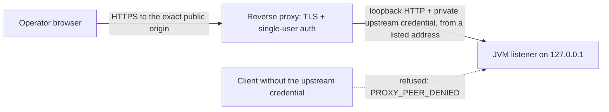

# Optional reverse-proxy profile

Design authority: [#216](https://github.com/minsago-elite/decomp_thing/issues/216)
([#613](https://github.com/minsago-elite/decomp_thing/issues/613) access topology,
[#614](https://github.com/minsago-elite/decomp_thing/issues/614) streams, uploads, downloads and base paths)
and the Host/Origin allowlist of [#480](https://github.com/minsago-elite/decomp_thing/issues/480).
The default local profile in [browser trust](web-trust.md) is unchanged: loopback binding, the
configured loopback origin and aliases only, and every forwarding header refused.

This profile lets one operator reach the SPA workbench through a TLS-terminating, authenticating
reverse proxy that runs **on the same host** as the JVM. It is not a multi-user service.

## Proposed topology (qualification pending)

These adapters and the test-owned fixture are a proposal for review under #613, not an approved
production topology. #216/#613/#614/#480/#161 remain open for acceptance and prerequisite #174;
HTTP fixture coverage does not complete real-proxy/TLS/browser qualification.



| Element | Requirement |
| --- | --- |
| JVM listener | `--host` stays a loopback address. Non-loopback binding remains refused in every mode, before storage or a listener is created. |
| Proxy-to-JVM hop | Requires both a listed loopback source address (`--trusted-proxy`, literals only, no DNS) and the private 256-bit `X-Decomp-Proxy-Secret` credential loaded from `--proxy-secret-file`. Missing, wrong or repeated credentials and unlisted peers receive `403 PROXY_PEER_DENIED` before routing/body consumption. A loopback IP alias is **not** process isolation: direct clients can select the proxy's source IP too. |
| Public origin | `--public-origin` is the exact `https://host[:port]` the browser uses: lowercase, no path, no default `:443`, no credentials. It is the only accepted Host/Origin pair; the loopback listener origin and localhost aliases are refused with `HOST_DENIED`/`ORIGIN_DENIED`. |
| Base path | `--base-path` is the public prefix (for example `/decomp/`). The proxy forwards it **unchanged**. A request outside it from a trusted peer means the proxy strips the prefix, which is unsupported and answered with `404 PROXY_BASE_PATH_MISMATCH`. |
| TLS | Terminated at the proxy. The proxy declares it with `X-Forwarded-Proto: https` (or RFC 7239 `proto=https`); without it the request fails with `403 PROXY_FORWARDING_INVALID`. |
| User authentication | Performed by the proxy for a single operator (examples use HTTP basic authentication). The workbench additionally requires its own one-use bootstrap session; proxy authentication is not a substitute and cannot be asserted through headers. |
| UI | `--ui spa` only. `--dev-frontend-origin` cannot be combined with the profile. |

Start it with all three profile options; any incomplete combination exits before storage or a
listener is created. Provision a random secret (for example `umask 077; openssl rand -hex 32 >
decomp-proxy.secret`), then provide the **same** value to the JVM and proxy through protected
service configuration. The JVM file must be a regular non-symlink file containing exactly 64
lowercase hexadecimal characters, optionally followed by one LF; reads are bounded to 66 bytes.
The file path, not the credential, is passed on the command line:

```sh
llm_bin_patch web --ui spa --host 127.0.0.1 --port 8000 --base-path /decomp/ \
  --public-origin https://decomp.example --trusted-proxy 127.0.0.1 \
  --proxy-secret-file /etc/decomp/decomp-proxy.secret
```

Run the JVM and proxy under dedicated service identities. Keep each service's secret copy/config
owner-readable only (for example mode `0600`), outside job storage, source control and web roots;
never log the header, put its value in a URL, send it to the browser or reuse the operator's Basic
credential. The JVM retains only its digest and compares credential digests in constant time.
The proxy must **overwrite** any incoming `X-Decomp-Proxy-Secret` after authenticating the user,
never append or copy a client value. Reload both services to rotate it. File permissions and service
identity separation are deployment obligations, not enforced by the JVM: a process able to read
either service's secrets (including an untrusted process under the same OS identity), inspect its
memory or administer the host is outside this boundary. Loopback prevents remote network access;
it does not make the plaintext hop confidential from a privileged host observer.

The launcher prints the loopback listener, the admitted peers and a one-use handoff
`https://decomp.example/decomp/#bootstrap=…`. It reaches only the operator's terminal, expires in
five minutes, is consumed by the first exchange and is still useless without passing the proxy's
authentication. Do not paste it anywhere else.

The JVM cannot see whether the proxy really authenticated the user or holds a valid certificate.
It verifies the parts it can observe: the private upstream credential, peer address, declared
protocol, exact Host and Origin, and the base path. Browsers send `Origin: https://…` and return `Secure` cookies only over
HTTPS, so the exact-origin check and the cookie attributes are what bind the session to TLS; the
forwarded protocol is a consistency check that catches a misconfigured hop.

The proposed reference fixture is the test-owned, basic-authenticating nginx-like hop in
`src/test/kotlin/decompengine/web/WebReverseProxyProfileTest.kt`: it refuses unauthenticated
requests itself, strips the operator credential, overwrites the private upstream credential and
forwarding headers, enforces the declared Content-Length edge ceiling, and buffers responses
unless they carry `X-Accel-Buffering: no`. Login traverses this hop; direct token/cookie replay
from the proxy's own source address without the upstream secret is a negative control. The nginx (1.25.1 or later,
`auth_basic`) and Caddy (2.8 or later, `basic_auth`) configurations below are maintained examples
of that topology; this repository has not qualified those products' binaries.

## Forwarded-header allowlist

Values from trusted peers are verified against the configuration and never adopted: no header
selects an origin, a path, a client address or an identity.

| Header | Accepted from a trusted peer when |
| --- | --- |
| `X-Forwarded-Proto` | exactly `https` |
| `Forwarded` | its last element (the nearest hop's) is well formed; `proto`, if present, is `https`; `host`, if present, is the public authority |
| `X-Forwarded-Host` | exactly the public authority |
| `X-Forwarded-Port` | the public port (`443` by default) |
| `X-Forwarded-For`, `X-Real-IP` | bounded and free of control characters; ignored otherwise |

Any other `X-Forwarded-*` header (for example `X-Forwarded-Prefix`) and identity headers such as
`X-Forwarded-User`, `X-Forwarded-Email`, `Remote-User`, `X-Remote-User` and `X-Auth-Request-*`
are refused with `403 FORWARDED_HEADERS_DENIED` rather than silently ignored, so a proxy that
forwards identity is noticed. Without the profile, every forwarding header from every peer is
refused as before.

## Session, cookie and CSRF policy

- The session cookie is `__Secure-decomp_session_…; Path=<base path>; HttpOnly; SameSite=Strict; Secure`,
  with no `Domain`. The `__Secure-` prefix makes browsers refuse it over plain HTTP.
- Mutations require the cookie, `Origin` equal to the public origin and `X-CSRF-Token`, exactly as
  locally. Session exchange requires the public Origin and the one-use token. `Origin: null`, a
  downgraded `http://` origin, another port and cross-site Fetch Metadata are refused.
- The proxy must not cache or rewrite cookies. Clear `Authorization` towards the JVM so the
  operator's basic-auth credential is not forwarded; the JVM never reads it.

## Timeouts, upload limits and event streams

The JVM enforces its own bounds regardless of the proxy. The finite edge body ceiling is deliberately
**higher** than the application's unchanged 32 MiB multipart-request ceiling: ordinary oversized
uploads (including a 32 MiB file plus framing) reach the JVM and receive its typed JSON refusal
with `X-Request-ID`. An equal 32 MiB edge ceiling would intercept that response. Bodies over the
separate 64 MiB edge ceiling may instead receive an opaque proxy-generated 413; no application
request ID or typed envelope is promised for those requests. The SPA treats that as a transport
failure (`invalid_headers`), not `UPLOAD_TOO_LARGE`. This outer safety limit is not a larger
application upload allowance. The fixture models Content-Length refusal, not every real adapter's
chunked-body or timeout behavior; real-adapter qualification remains open.

| Concern | Server behaviour | Proxy setting |
| --- | --- | --- |
| Upload size | 32 MiB per multipart request including framing; larger bodies reaching the JVM get `413 UPLOAD_TOO_LARGE` | finite outer ceiling: nginx `client_max_body_size 64m;`, Caddy `request_body { max_size 64MiB }`; above it, edge-generated refusal as described above |
| Upload streaming | Progress (`X-Upload-ID`) and limits apply as bytes arrive; 120 s total upload deadline | nginx `proxy_request_buffering off;` on the upload route; Caddy streams by default |
| Ordinary request | 30 s deadline | read timeout above 30 s (examples use 60 s) |
| Event stream (SSE) | `text/event-stream`, heartbeat comment every 15 s, 30 s lease then the browser reconnects with `Last-Event-ID`; responses carry `X-Accel-Buffering: no` and `Cache-Control: no-store, no-transform` | disable response buffering and compression for `…/events`; nginx `proxy_buffering off;` (the header already does this), Caddy `flush_interval -1`; read timeout above the heartbeat |
| Download | Fixed-length `application/octet-stream` attachment, `no-store`; no `Range` | default buffering is acceptable; do not cache |

A proxy that buffers the stream delays every event until the lease ends; the test suite proves the
same request is prompt through a hop that honours `X-Accel-Buffering: no` and is not through one
that buffers regardless.

## nginx example

```nginx
server {
    listen 443 ssl;
    http2 on;
    server_name decomp.example;
    ssl_certificate     /etc/ssl/decomp.example/fullchain.pem;
    ssl_certificate_key /etc/ssl/decomp.example/privkey.pem;

    # Single-user authentication at the edge; the workbench session is still required.
    auth_basic           "decomp workbench";
    auth_basic_user_file /etc/nginx/decomp.htpasswd;
    client_max_body_size 64m;
    client_body_timeout 120s;

    location /decomp/ {
        # No URI after the upstream address: the base path is forwarded unchanged.
        proxy_pass http://127.0.0.1:8000;
        proxy_http_version 1.1;
        proxy_set_header Connection "";
        # $http_host keeps a non-default public port; the JVM refuses any other Host.
        proxy_set_header Host $http_host;
        proxy_set_header X-Forwarded-Host $http_host;
        proxy_set_header X-Forwarded-Proto $scheme;
        proxy_set_header X-Forwarded-For $remote_addr;
        # Overwrite, never append, client-supplied forwarding and credentials.
        proxy_set_header Forwarded "";
        proxy_set_header X-Real-IP "";
        proxy_set_header Authorization "";
        # Root/service-private include sets X-Decomp-Proxy-Secret to the provisioned value.
        include /etc/nginx/decomp-upstream-secret.conf;
        proxy_read_timeout 60s;
        proxy_send_timeout 60s;
        proxy_request_buffering off;
        proxy_cache off;
    }

    # Event streams: the server sends X-Accel-Buffering: no; this makes it explicit.
    location ~ ^/decomp/api/v1/jobs/[^/]+/runs/[^/]+/events$ {
        proxy_pass http://127.0.0.1:8000;
        proxy_http_version 1.1;
        proxy_set_header Connection "";
        proxy_set_header Host $http_host;
        proxy_set_header X-Forwarded-Host $http_host;
        proxy_set_header X-Forwarded-Proto $scheme;
        proxy_set_header X-Forwarded-For $remote_addr;
        proxy_set_header Forwarded "";
        proxy_set_header X-Real-IP "";
        proxy_set_header Authorization "";
        include /etc/nginx/decomp-upstream-secret.conf;
        proxy_buffering off;
        proxy_cache off;
        gzip off;
        proxy_read_timeout 60s;
    }
}
```

The private include file contains `proxy_set_header X-Decomp-Proxy-Secret "<64-lowercase-hex>";`
with the actual provisioned value, not the placeholder. Both locations need it because nginx
`proxy_set_header` inheritance is all-or-nothing. Protect the include and any `nginx -T` output.
nginx connects from `127.0.0.1` by default, so start the workbench with `--trusted-proxy 127.0.0.1`.
`proxy_bind 127.0.0.2` plus `--trusted-proxy 127.0.0.2` is an optional routing choice, **not** an
isolation control. The private credential, not the source-IP alias, authenticates the upstream.

## Caddy example

```caddyfile
decomp.example {
    @decomp path /decomp /decomp/*
    handle @decomp {
        basic_auth {
            operator <bcrypt hash from `caddy hash-password`>
        }
        request_body {
            max_size 64MiB
        }
        # Caddy keeps Host and replaces X-Forwarded-For/-Proto/-Host when no trusted_proxies are set.
        reverse_proxy 127.0.0.1:8000 {
            # Protected service environment; overwrites any client-supplied value.
            header_up X-Decomp-Proxy-Secret {$DECOMP_UPSTREAM_SECRET}
            header_up -Authorization
            header_up -Forwarded
            header_up -X-Real-IP
            flush_interval -1
        }
    }
}
```

Provision `DECOMP_UPSTREAM_SECRET` in Caddy's private service environment with the same 64-character
value as the JVM secret file, not a public shell argument. Protect Caddy's admin/configuration
access and environment; it holds this credential. Run the JVM with `--trusted-proxy 127.0.0.1`
(or `::1` if Caddy dials `[::1]:8000`) and `--proxy-secret-file`.

## Unsupported topologies

| Topology | Result |
| --- | --- |
| Binding the JVM to a non-loopback address, or a proxy on another host or container network | refused at startup (`loopback`); the private credential is not encrypted transport and does not authorize a remote upstream hop |
| Prefix stripping (`proxy_pass http://127.0.0.1:8000/;`, `handle_path`) | `404 PROXY_BASE_PATH_MISMATCH` |
| Plain-HTTP public origin, or a hop without `X-Forwarded-Proto: https` | startup refusal, or `403 PROXY_FORWARDING_INVALID` |
| Rewriting Host to the upstream address (nginx's default `$proxy_host`) | `403 HOST_DENIED` |
| Forwarding user identity headers | `403 FORWARDED_HEADERS_DENIED` |
| Direct access to the JVM port without the private upstream credential, even from the proxy's own source address | `403 PROXY_PEER_DENIED` |
| Legacy UI, development frontend origin | refused at startup |

## Limitations

- **Single user, shared workspace.** Everyone who passes the proxy and holds a workbench session
  sees and changes the same job store. There are no per-user jobs, roles or audit identities; the
  workbench has one operator's authority. Multi-tenant authorization is out of scope and would be
  separate future work.
- User authentication is outside the JVM's view. The private upstream credential authenticates the
  hop, not the browser or a tenant. A misconfigured proxy that injects it without authenticating
  users leaves only the workbench bootstrap/session protecting those users.
- Session records, CSRF keys and bootstrap tokens are process-local; restarting the JVM signs out
  every browser, as it does locally.
- Qualification here is HTTP-level, against the real listener and the test-owned hop above. It does
  not cover a particular proxy build, certificate management or a browser behind a real proxy.
