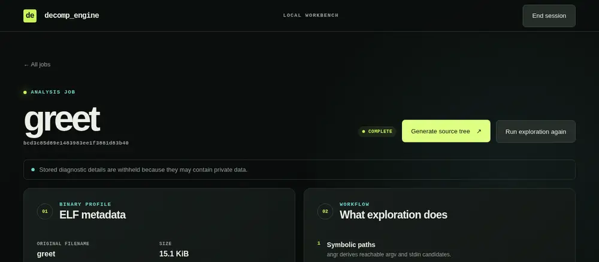
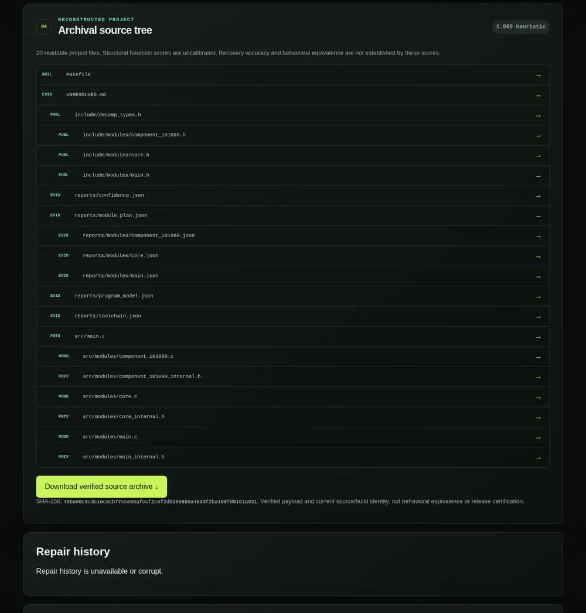
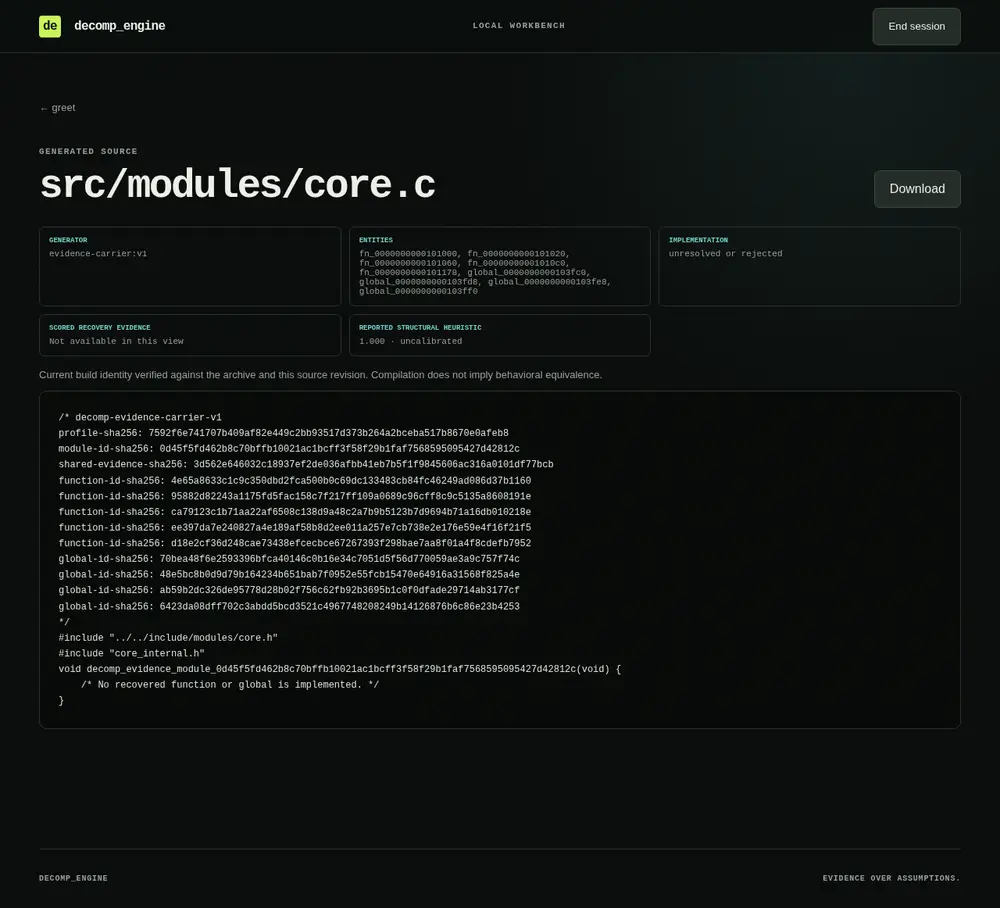
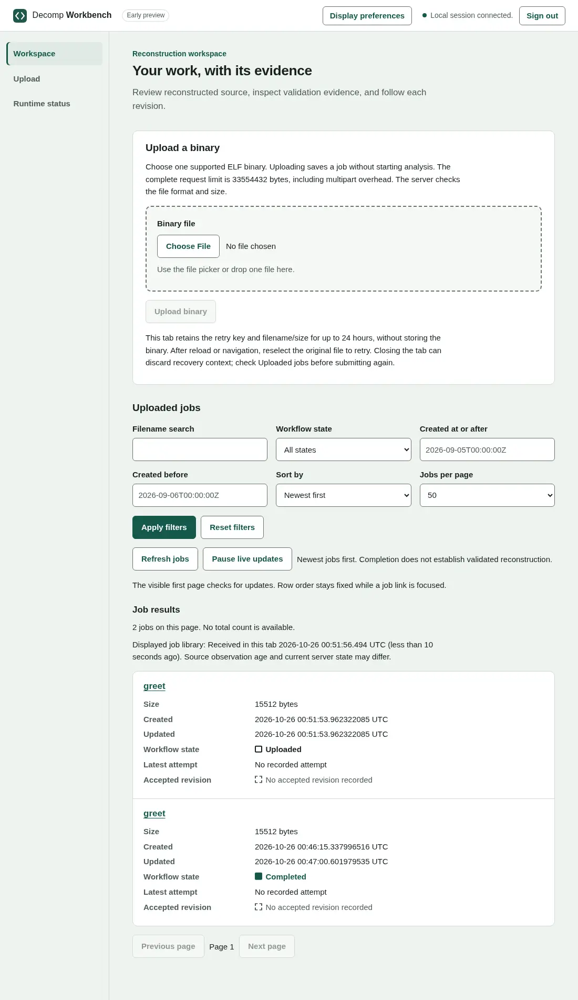
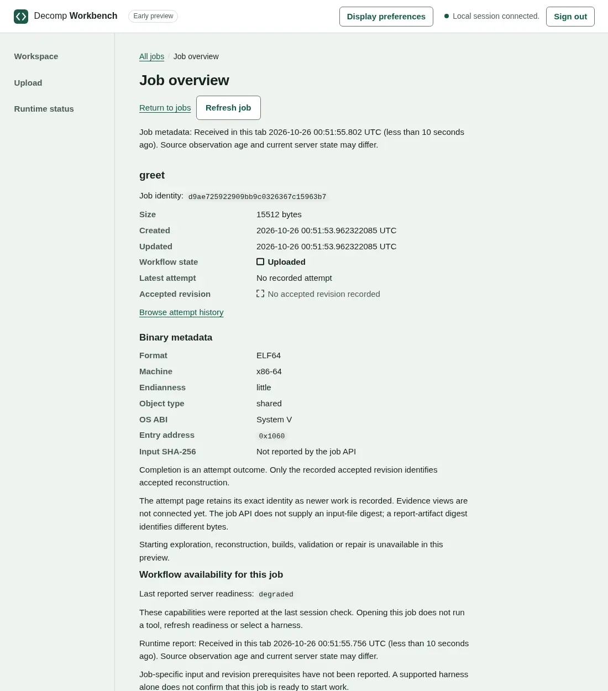
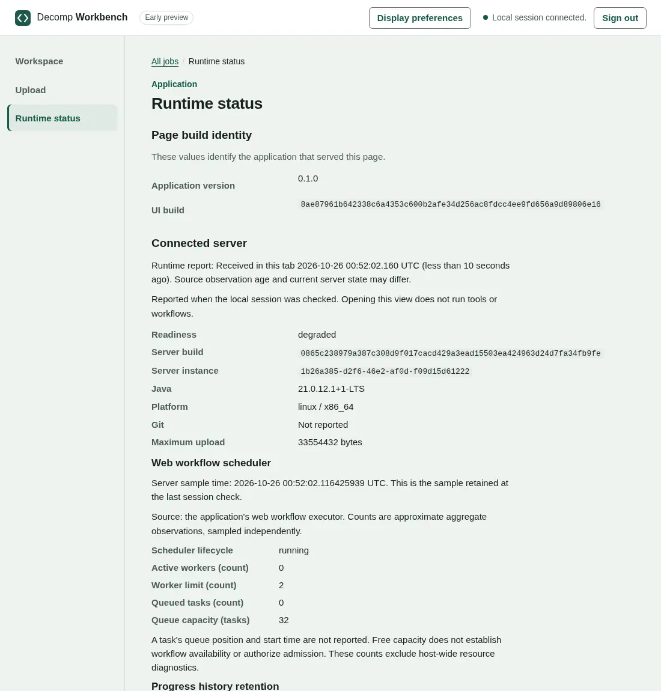

# Workbench user guide

This guide is for people who want to run the browser workbench and understand what it will and will not do for them.
Everything described here was observed on a build of `master` (`a85521d7`, 26 October 2026) by running the installed
launcher against a harmless synthetic ELF: a two-function `printf` program compiled with `cc -O1`. Anything not observed
is marked **read from the code**, **from tests** or **not verified**. Features that exist only in open pull requests are
listed in [Coming next](#coming-next) and are **not available** in a `master` build. Developers building or packaging the UI
should read [packaging and preview usage](web-packaging.md) instead.

## Two interfaces

The `web` command serves one of two interfaces:

| Interface | Command | What it is |
|---|---|---|
| Legacy workbench (default) | `llm_bin_patch web` | The full workbench. It handles uploads, exploration, archival reconstruction, source browsing and verified archive downloads. This is the only interface that starts analysis today. |
| Embedded preview | `llm_bin_patch web --ui spa` | The new Preact interface that ships inside the application JAR. It is a **read-and-upload preview**: see [The embedded preview](#the-embedded-preview). |

Both use the same local-session security model and read the same data directory. One server at a time can own a data
directory, so you can switch between them by stopping one and starting the other.

## What you need

**To run the installed application**: Linux x86-64, JDK 21 (the version the container image and CI use), and the
distribution produced by `./gradlew installDist` (or the `distZip`/`distTar` archives). Both interfaces are **inside the
application JAR**. Nothing is fetched from Node, a CDN or an external web server at run time. The browser needs no plugin,
no Node and no credentials.

**To build it** (developers only): the pinned Node/npm from [`.node-version`](../.node-version), installed with
`scripts/install-frontend-node.sh`. Node is a build-time dependency of the embedded interface and nothing else. See
[packaging and preview usage](web-packaging.md).

**For analysis work** (separate from the interface):

- **Ghidra** is a hash-locked **bundled** dependency, not something to install. A missing bundled artifact is an
  availability failure of the application, not a `GHIDRA_HOME` you should set.
- **Exploration** runs the uploaded binary in the mandatory bubblewrap sandbox and needs angr. Set `ANGR_PYTHON` if angr
  is not importable by the default Python.
- **Agent reconstruction** needs a provisioned ACP agent (`ACP_CONFIG_FILE`; see the README). Evidence-only
  reconstruction needs no agent.

`doctor` checks this toolchain; see [Checking readiness](#checking-readiness).

## Launch

```sh
./gradlew installDist
build/install/llm_bin_patch/bin/llm_bin_patch web --data-dir /srv/decomp/jobs           # legacy workbench
build/install/llm_bin_patch/bin/llm_bin_patch web --ui spa --data-dir /srv/decomp/jobs  # embedded preview
```

> **Choose a data directory whose absolute path has no component starting with `.`**, for example not
> `.decomp_engine/jobs` (the default) and not anything under `~/.local`. Bundled Ghidra refuses such project paths, so
> every reconstruction in that directory fails with *"Path element starting with '.' is not permitted"* in
> `reports/analysis/reports/ghidra_stderr.log`. Uploading and browsing still work. Tracked in
> [#1785](https://github.com/minsago-elite/decomp_thing/issues/1785).

| Option | Default | Meaning |
|---|---|---|
| `--host` | `127.0.0.1` | Interface to bind. Keep the default. The preview refuses any non-loopback host. Remote or proxied operation is not supported on `master`. |
| `--port` | `8000` | TCP port. |
| `--data-dir` | `.decomp_engine/jobs` | Where jobs are stored (see [Your data](#your-data) and the warning above). |
| `--ui` | `legacy` | `legacy` or `spa`. |
| `--base-path` | `/` | Serve under a prefix such as `/workbench/`. **Only with `--ui spa`**: the legacy workbench refuses to start with `--base-path is supported by --ui spa`. |

`llm_bin_patch --help` lists every option. There is no `--version` option, and `web --help` is not an option (it fails
with `--help requires a value`). The build identities are on the preview's **Runtime status** page.

On start the launcher prints two lines:

```text
Serving decomp_engine spa UI on http://127.0.0.1:8000/
Open local browser session (expires 2026-10-26T00:51:07.075094419Z): http://127.0.0.1:8000/#bootstrap=<token>
```

Open the second URL in your browser. The legacy workbench prints the same pair, with the link at `/login#bootstrap=…`.

## Sessions

- The printed link is a **single-use, five-minute** local session link. Opening it removes the token from the address
  bar and starts a session. A session ends after **30 minutes of inactivity**, or **eight hours** after it started,
  whichever comes first (the cookie's `Max-Age` is eight hours, which is the ceiling, not the usual lifetime). Its cookie
  is `HttpOnly; SameSite=Strict`.
- The launcher prints **one** link per start. To open a second browser, or to sign in again after a session ends, restart
  the launcher.
- Using the link a second time fails with `BOOTSTRAP_REQUIRED: Open a newly issued local browser link.` Opening it
  after the five minutes have passed fails with a different code, `BOOTSTRAP_EXPIRED: The local browser link expired.
  Issue a new link.`
- A session that has expired (idle or absolute) is answered with `401 SESSION_EXPIRED: The browser session expired. Open a
  new local browser link.` (read from the code; the 30-minute idle expiry was not waited out). Without any session,
  the API answers `401 SESSION_REQUIRED: Open a local browser link to start a session.` The public
  pages (`/`, `/runtime` in the preview, `/login` in the legacy workbench) still load so the interface can explain itself.
- **Sign out** (preview) or **End session** (legacy) ends the session explicitly. Creating a session, navigating,
  refreshing or opening a saved link never starts or changes anything.

## Walkthrough: the legacy workbench

This is the end-to-end path that works on `master`: upload, explicit start, status, evidence, source and archive.

**1. Upload.** On the dashboard (`/`), under **Add an ELF binary**, choose a file and select **Create analysis job**. The
browser moves to the job page (`/jobs/<id>`). The job is `UPLOADED`: the server has read the ELF header (format,
endianness, OS ABI, object type, machine, entry point, header counts) and **nothing has run**.

**2. Start one workflow explicitly.** The job page has two buttons, and only selecting one starts work:

- **Start automatic exploration** runs the binary in the sandbox to generate validation inputs. It needs angr. On a host
  without angr, the attempt ends `FAILED`.
- **Generate source tree** runs archival reconstruction. By default it uses the configured ACP agent. To use the
  evidence-only policy instead, start the launcher with `WEB_RECONSTRUCTION_MODE=evidence-only` in its environment.
  There is no fallback: a missing agent never silently switches to evidence-only.



**3. Follow status.** The page refreshes itself while work is queued or running. A second start on the same job is
refused with *"Analysis already running"* (read from the code). When work ends, the status shows `COMPLETE` or `FAILED`. After any completed
workflow, the exploration button is labelled **Run exploration again**, even if exploration itself never ran. Stored
failure text is **not** shown (*"Stored diagnostic details are withheld because they may contain private data."*), so
run `doctor` (below) to learn why a workflow failed. If the server stops while work is queued or running, the next
start records the job as interrupted (failed). It does not replay it, and retrying is a new explicit start (from tests).

Observed: an evidence-only reconstruction of the synthetic binary finished in about 45 seconds with status `COMPLETE`.

**4. Inspect evidence.** The **Evidence** sections show the exploration report (when exploration ran), reconstruction
progress (here *"Source reconstruction · Unresolved, 3 / 3 modules"*) and **Agent progress**. Agent progress lists phase
events only: *"Message, plan and tool text is withheld because this journal does not certify public visibility."*
**Repair history** shows recorded repair iterations; when no repair has run, it reads *"Repair history is unavailable or
corrupt."*, which does not mean anything is damaged. **Artifacts** lists every retained report file,
including Ghidra project files and logs, each with a download link.

**5. Browse source.** **Archival source tree** lists the generated project files with their role (build, evidence,
public header, entry, module, private header). A **structural heuristic** score is shown with the warning that it is
uncalibrated. Selecting a file opens `/jobs/<id>/source/<path>`. That page shows the generator, the entities the file
covers, whether the implementation was accepted (*"unresolved or rejected"* for every evidence-only module), the source as
escaped text, and a **Download** link for the file's exact bytes. `UNRESOLVED.md` lists every unresolved entity.





**6. Verify and download the archive.** **Download verified source archive** appears only after the server has checked
`source-tree.zip` against its manifest and the current source revision. The archive's SHA-256 is printed beside it, and
the label says what was **not** checked: *"Verified payload and current source/build identity; not behavioral
equivalence or release certification."* When the check is not possible, the page says *"Archive verification is
unavailable for the current source/build revision."* and offers no verified link. To re-check a download yourself:

```sh
sha256sum source-tree.zip            # equals the SHA-256 printed on the job page
unzip -q source-tree.zip -d source-tree && cd source-tree
sha256sum -c --quiet ARCHIVE_MANIFEST.sha256 && echo payload verified
```

Both checks passed for the observed run. `ARCHIVE_README.md` and `BUILDING.md` inside the archive explain how to build
it. An evidence-only tree compiles a diagnostic inventory and supplies no recovered implementation.

## The embedded preview



Verified against the running preview:

- **Upload a binary** (on the workspace `/`, or `/upload`): the server's reported `maxUploadBytes` is **32 MiB
  (33,554,432 bytes) for the whole upload request**, including its multipart framing, so a file at or just under 32 MiB
  can be rejected with `UPLOAD_TOO_LARGE`; keep files comfortably smaller. The page shows progress. A successful upload
  opens the new job's overview with status **Uploaded**; **no analysis starts**.
- **Retrying an interrupted upload is safe, and it is yours to start.** The page does **not** retry automatically. If the
  connection drops or the result is unconfirmed, the tab keeps the upload's retry key and the file's name and size
  (never the binary) for up to 24 hours. It asks you to choose the original file again and retry. The server then
  returns the **same job** and does not create a duplicate (verified at the API with a repeated idempotency key).
- **Job library** (`/`): every job in the data directory, including jobs created by the legacy workbench, newest first by
  default, 50 per page (up to 200). You can filter by filename, workflow state and a created-between range, and sort
  oldest or newest first. Applied filters become part of the address, so a filtered view can be bookmarked. The first
  page refreshes itself; **Pause live updates** stops that.
- **Job overview** (`/jobs/<id>`): stored facts and ELF metadata, plus the server's last capability report.
- **Attempt history** (`/jobs/<id>/runs`): durable attempts for the job.
- **Runtime status** (`/runtime`): the page's application version and UI build, and the connected server's build,
  instance, Java version, platform, upload limit, workflow scheduler counts and progress-history retention.





**What the preview cannot do on `master`.** It starts no workflows. The server reports a `workflows` capability as
`unavailable` (*"Workflow actions are unavailable in this preview."*, reason `PREVIEW_UNAVAILABLE`), and every workflow on
the job page reads *"Starting this workflow is unavailable in this preview."* Overall readiness is `degraded`. That is
expected, not a fault. It also cannot edit or delete a job or work with Git.

**Legacy work is not shown as attempts.** A job reconstructed by the legacy workbench appears in the preview with its
workflow state (for example **Completed**), *"No recorded attempt"* and *"No accepted revision recorded"*. Its attempt
history says *"No durable attempts are recorded for this job. Legacy activity does not have invented attempt identities."*
To browse that job's source or download its archive, use the legacy workbench.

**Views that need durable attempts** (read from the code and component tests; a `master` build cannot create the
attempts they need, so they were not reachable in the observed run):

- **Attempt pages** (`/jobs/<id>/runs/<run>`, `…/activity`, `…/evidence`): attempt state, acceptance, recorded harness,
  limits and usage, progress activity, exploration and validation evidence. Activity can be pinned with **Pin progress
  history**. The attempt-level controls can cancel, recover or **Retry as a new attempt** (*"Nothing from this attempt's
  execution is restored, and this attempt stays unchanged."*).
- **Source browsing** (`/jobs/<id>/runs/<run>/revisions/<revision>/sources`): a paged directory tree with breadcrumbs,
  file metadata and a bounded text preview. **Download complete recorded input** gives the exact bytes, and an explicit
  **Check digest** button asks the server to compare the downloadable file with its recorded digest (*"A match checks
  file bytes; it does not verify compilation, behavior, an archive or accepted reconstruction."*).
- **Downloads**: *Download observed exploration JSON* and *Download this validation page JSON*.

## Harnesses and evidence-only output

- **Capability-gated.** A workflow is offered only when the server reports a capability for it. The preview's Runtime
  status shows `harness: unavailable` with *"No agent harness is configured."* (`HARNESS_NOT_CONFIGURED`) when
  `ACP_CONFIG_FILE` is unset. Other reasons include `HARNESS_CONFIGURATION_INVALID`, `SANDBOX_HELPER_MISSING` and
  `GHIDRA_MISSING` (*"…reinstall the complete application."*) (read from the code). Reporting a harness never grants
  workflow authority, and opening a page never runs a probe.
- **No silent fallback.** Agent and evidence-only reconstruction are selected explicitly. A missing agent makes the
  agent workflow unavailable; it never switches to evidence-only.
- **Evidence-only limits.** Evidence-only output is a buildable diagnostic inventory. Every module is
  *"unresolved or rejected"*, `UNRESOLVED.md` lists every recovered entity as unassessed, and *"Rebuilds do not execute a
  recovered entrypoint."* A successful build of it accepts no implementation and establishes no recovered ABI or
  behavior.

## Complete, validated, accepted

The interface keeps three ideas apart on purpose, and says so in its own words:

- *"Completion is an attempt outcome. Only the recorded accepted revision identifies accepted reconstruction."*
- *"Completion does not establish validated reconstruction."* (shown beside every job list)
- *"Current build identity verified against the archive and this source revision. Compilation does not imply behavioral
  equivalence."* (legacy source pages)

Read them as three separate questions:

1. Did the attempt **finish** (complete)?
2. Was its output **checked against evidence** (validated)? Only a named validator answers this, and only for the scope it
   covered.
3. Was a specific revision **recorded as accepted**?

A finished attempt answers only the first. A verified archive confirms which bytes you have, not whether they behave like
the original. A structural heuristic score is uncalibrated and is not a recovery accuracy.

## Your data

Jobs live under `--data-dir`, one directory per job named by its 32-character id. Observed after one legacy
reconstruction and one preview upload:

```text
<data-dir>/
  .web-owner.lock  .workflow-owner.lock
  bcd3c85d89e1483983ee1f3881d83b40/       legacy upload, then Generate source tree
    input.elf  job.json
    reports/  agent-progress.json  agent-progress.lock  reconstruction.json  reconstruction_progress.json
              reconstruction_harness_selection.json  source-tree/  source-tree.zip  analysis/
  d9ae725922909bb9c0326367c15963b7/       preview upload
    input.elf  job.json  upload-receipt.json
```

Exploration adds `reports/exploration.json`. Durable attempts (not created by a `master` server) add
`workflow-state.json` and per-attempt reports under `reports/runs/<run>/`.

- **Location.** Keep the data directory **outside** the installed distribution; the application files are immutable.
  Avoid dot-prefixed path components (see [Launch](#launch)). `job.json` records the job's absolute input path, so a job
  directory is tied to where it was created. Do not move or rename the data directory.
- **One server per data directory.** Ownership is enforced with a lock file (`.web-owner.lock`). If the directory
  already exists, a second server is refused at start-up with `Job store already has a live web server owner` (checked in
  both interfaces). If the directory does **not** exist yet, a server starts without creating it or taking the lock, so
  a second server can also start. The lock is taken when storage is first initialised (by the first upload), and a
  competing server is then refused (read from the code). To avoid the window, create the directory first.
- **Retention.** Jobs are **never deleted automatically**, and neither interface can delete a job. The preview server
  expires a finished attempt's **progress history** (not its job, reports or archives) no sooner than **24 hours** after
  the attempt ends. **Pin progress history** on an attempt keeps it; unpinning re-enables cleanup. The legacy server does
  not run this cleanup.
- **Storage limits.** New uploads are admitted only while the retained data stays under a **20 GiB** logical ceiling and
  the filesystem keeps 64 MiB of headroom beyond the upload. Otherwise the upload is refused with `UPLOAD_STORAGE`, and
  nothing is deleted to make room (read from the code and tests).
- **Recovery files.** Interrupted uploads can leave staging directories. The server removes only staging that it can
  prove belongs to its current protocol, and only at start-up. The dashboard reports any other retained recovery files
  and never deletes them; inspect them before removing anything.
- **Downloads.** Legacy: every artifact, every generated source file and the verified source archive. Preview: only the
  attempt-bound downloads listed above. Downloads are served as attachments and never executed.
- **Backups.** Stop the server first. Copy the whole data directory with its permissions and timestamps (for example
  `cp -a`), and restore it to the **same absolute path** before starting a server on it again. Do not copy a directory a
  live server owns. A tested procedure with hash verification is being added in
  [#1794](https://github.com/minsago-elite/decomp_thing/pull/1794); until it lands, check a restored copy by comparing
  file hashes with the original.

## Checking readiness

```sh
build/install/llm_bin_patch/bin/llm_bin_patch doctor --tools-only
```

Each check prints `[ok]` or `[failed]` with what to do. Observed on the verification host, which has no angr:

```text
[ok] Java: Check passed.
[ok] C compiler: Check passed.
[ok] Make: Check passed.
[ok] binutils/readelf: Check passed.
[ok] binutils/strings: Check passed.
[ok] Python: Check passed.
[failed] angr: Install angr for the selected Python interpreter or set ANGR_PYTHON.
[ok] Ghidra: Check passed.
[ok] C sanitizers: Check passed.
[ok] bubblewrap: Check passed.
[ok] output directory: Check passed.
[ok] reconstruction profile: Check passed.
[ok] diagnostic limits: Check passed.
Environment check failed (1 check(s)); resolve each [failed] item above.
```

The exit status is non-zero when any check fails. `--tools-only` needs no agent. Plain `doctor` also checks the agent
harness (see the README), and `doctor --workflow web` checks the web workflow's prerequisites.

## Collecting support information

`master` has no built-in support export. When you report a problem, collect only these:

- the **reference** shown with an error message (a request id);
- the build identities from **Runtime status** (application version, UI build, server build);
- the output of `doctor --tools-only`;
- the launcher command you used, with private paths replaced;
- the **first line** of any startup error, only after reviewing it and replacing private paths, hostnames and sensitive
  values with placeholders. Taking only the first line does **not** sanitize it; omit the text if you cannot safely redact it.

Do **not** attach:

- uploaded binaries (`input.elf`) or job directories;
- `job.json`, which records the host path of the input and may hold stored failure text;
- report files and logs, which can contain host paths;
- the session link or cookies;
- ACP configuration or environment variables.

A scoped, previewable support export with shared redaction is coming in
[#1704](https://github.com/minsago-elite/decomp_thing/pull/1704).

## When something goes wrong

Start-up refusals are printed as a Java exception. The message after the exception class on the first line is the part
that matters.

| You see | Meaning and what to do |
|---|---|
| `Cannot bind web server to 127.0.0.1:8000. Check --host or choose an unused --port.` | The port is busy. Pick another with `--port`. |
| `Job store already has a live web server owner` | Another server owns this data directory. Stop it, or use a different `--data-dir`. |
| `the SPA preview currently requires a loopback host` | `--ui spa` was started with a non-loopback `--host`. Use the default `127.0.0.1`. |
| `--base-path is supported by --ui spa` | `--base-path` was given to the legacy workbench. Add `--ui spa` or drop the option. |
| `--help requires a value` | `web --help` is not an option. Use `llm_bin_patch --help`. |
| Reconstruction ends `FAILED`; `ghidra_stderr.log` says *"Path element starting with '.' is not permitted"* | The data directory path has a dot-prefixed component ([#1785](https://github.com/minsago-elite/decomp_thing/issues/1785)). Stop the server and start it on a directory without one. Existing jobs stay where they are. |
| Exploration ends `FAILED` on a host without angr | `doctor --tools-only` reports `[failed] angr`. Install angr or set `ANGR_PYTHON`, restart the launcher and start exploration again. |
| *"Stored diagnostic details are withheld because they may contain private data."* | Expected for every failed legacy job. Use `doctor` and, if you must, the job's report logs on the server. |
| `BOOTSTRAP_REQUIRED` / "Open a newly issued local browser link." | The link was already used (or does not match). Restart the launcher and open the new link. |
| `BOOTSTRAP_EXPIRED` / "The local browser link expired. Issue a new link." | More than five minutes passed before the link was opened. Restart the launcher and open the new link. |
| `SESSION_REQUIRED` / "Open a local browser link to start a session." | You are not signed in. Open the launcher's link. |
| `SESSION_EXPIRED` / "The browser session expired. Open a new local browser link." | Your session ended (30 minutes idle, or eight hours in total). Restart the launcher and open the new link. |
| "The local session expired or is unavailable. Reconnect the session to read this job." | Your session ended (30 minutes idle, or eight hours in total). Restart the launcher for a new link. |
| "This job is unavailable. It may have been removed." | The job id does not exist (or was removed from the data directory). The page keeps a **Return to jobs** link. |
| "This interface cannot read the server's response format. Refresh the page before trying to read this job again." | The page and the server are different builds; **Runtime status** shows both identities. Refresh the page; if it persists, restart the launcher. |
| "Stored jobs could not be listed completely. The server has not returned a partial library; inspect job storage before retrying." | A stored job directory is damaged or unreadable. The server will not show a partial list; check the data directory. |
| "This page snapshot expired. Refresh jobs to start a new snapshot." | A paged listing went stale. Use **Refresh jobs**. |
| `UPLOAD_TOO_LARGE` / `UPLOAD_STORAGE` | The request is over 32 MiB, or the retained-data ceiling or free space would be exceeded. See [Your data](#your-data). |
| Startup fails before a socket is bound because packaged interface files are missing or inconsistent | Documented in [packaging and preview usage](web-packaging.md); **not reproduced here**. Reinstall or rebuild the distribution. |

## Git and pull requests

**`master` has no Git integration.** Runtime status shows **Git: Not reported**, neither interface has Git views, and the
workbench never runs `git`. A data directory placed inside one of your repositories leaves its `HEAD`, refs, index and
objects untouched (checked against `master` by the migration test in
[#1787](https://github.com/minsago-elite/decomp_thing/pull/1787), not yet merged). Jobs need no Git to be fully usable.

**To version reconstructed source today, do it yourself, outside the workbench:**

```sh
sha256sum source-tree.zip                           # compare with the SHA-256 on the job page
unzip -q source-tree.zip -d my-repo/recovered && cd my-repo/recovered
sha256sum -c --quiet ARCHIVE_MANIFEST.sha256
git add . && git commit -m "Recovered source from job <id>, archive <sha256>"
```

Track only the source archive's contents. Keep `input.elf`, job directories and `reports/analysis/` (Ghidra projects and
logs) out of the repository. Record the job id and archive digest in the commit so the commit can be traced back to the
evidence. A commit is not validation or acceptance.

**Coming.** The managed Git workflow is in open pull requests and is **not available yet**. They cover:

- initializing or importing a job repository that tracks source only;
- status, history and diffs;
- deliberate commits of selected files;
- branches, linked work trees, tags and source exports;
- remotes with server-side credentials, bounded fetch and divergence;
- reviewed integration with conflict resolution;
- an explicit push preview;
- optional GitHub pull requests.

See [Coming next](#coming-next) for the PR numbers. As designed, credentials stay on the server, are never shown in the
browser, and are never written to the data directory. Nothing is pushed without an explicit push. This section will be
rewritten against the real behavior when those pull requests land.

## Coming next

These are open pull requests at the time of writing. They are **not** part of a `master` build. This guide will be
updated as each one lands.

| Feature | Pull requests |
|---|---|
| Start exploration, reconstruction, build, validation and repair from the preview, with an explicit harness choice and limits | [#1700](https://github.com/minsago-elite/decomp_thing/pull/1700), [#1702](https://github.com/minsago-elite/decomp_thing/pull/1702), [#1706](https://github.com/minsago-elite/decomp_thing/pull/1706) |
| Source-archive status and explicit archive verification in the preview; revision comparison | [#1712](https://github.com/minsago-elite/decomp_thing/pull/1712), [#1707](https://github.com/minsago-elite/decomp_thing/pull/1707) |
| Revision-bound validation requests | [#1731](https://github.com/minsago-elite/decomp_thing/pull/1731) |
| Job deletion and retention settings | [#1694](https://github.com/minsago-elite/decomp_thing/pull/1694) |
| Shared redaction, sensitive-action audit and a scoped support export | [#1704](https://github.com/minsago-elite/decomp_thing/pull/1704) |
| Managed Git: reads, commits, branches and work trees, remotes and fetch, integration and conflicts, push | [#1701](https://github.com/minsago-elite/decomp_thing/pull/1701), [#1705](https://github.com/minsago-elite/decomp_thing/pull/1705), [#1708](https://github.com/minsago-elite/decomp_thing/pull/1708), [#1760](https://github.com/minsago-elite/decomp_thing/pull/1760), [#1765](https://github.com/minsago-elite/decomp_thing/pull/1765), [#1767](https://github.com/minsago-elite/decomp_thing/pull/1767) |
| Git workspace view; optional GitHub pull requests | [#1734](https://github.com/minsago-elite/decomp_thing/pull/1734), [#1771](https://github.com/minsago-elite/decomp_thing/pull/1771) |
| Optional authenticated reverse-proxy deployment | [#1780](https://github.com/minsago-elite/decomp_thing/pull/1780) |
| Legacy URL and saved-job migration record; backup, restore and operations guides | [#1787](https://github.com/minsago-elite/decomp_thing/pull/1787), [#1794](https://github.com/minsago-elite/decomp_thing/pull/1794) |

Screenshots in this guide were taken from the observed run (light theme, 1100–1280 CSS pixels wide) and cropped. The
interface is still changing, so details may drift between releases; the text above takes precedence.
